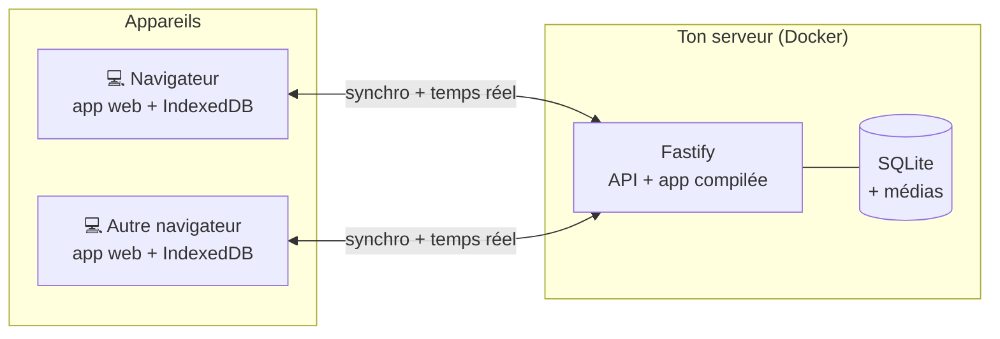

<div align="center">


# Athlos

**Suivi d'entraînement auto-hébergé : planifie tes séances, suis-les en direct, vois ta progression.**

[](LICENSE)


</div>

Athlos est une application web pour planifier ses séances, les suivre en direct et voir sa progression.
Elle tourne sur ton propre serveur (un petit ordinateur suffit) et garde une copie des données dans le
navigateur : une coupure de réseau n'interrompt rien, la synchronisation reprend au retour. Des apps
iPhone et Android natives sont prévues ; elles utiliseront la même API de synchronisation.

Pas de compte, pas de publicité, pas de service tiers : tes données restent chez toi.

## Fonctionnalités

**Bibliothèque**
- 876 exercices en français, avec images, consignes et muscles travaillés sur une silhouette anatomique.
- Filtres par groupe musculaire et recherche par nom.
- Tes propres exercices, avec photo, vidéo ou GIF (convertis automatiquement pour rester légers), ou une image
  importée depuis un lien Internet et gardée sur ton serveur.
- Ta version d'un exercice de la bibliothèque (nom, muscles, médias), rétablissable à tout moment.

**Séances**
- Créateur de séances : exercices réordonnés par glisser-déposer, supersets.
- Six types d'exercice : poids et répétitions, durée (gainage), distance et durée, etc.
- Séries d'échauffement, normales, dégressives ou jusqu'à l'échec ; repos réglé par série.

**En salle**
- Séance guidée : valeurs pré-remplies avec ta dernière performance, minuteur de repos (± 15 s), chrono.
- Un bip au volume réglable signale la fin du repos.

**Progression**
- Historique des séances, records personnels, 1RM estimé, volume.
- Graphiques de progression par exercice.

**Multi-appareils**
- Dans n'importe quel navigateur récent, avec une mise en page adaptée aux fenêtres étroites comme aux
  grands écrans.
- Synchronisation en temps réel entre les appareils.
- Couleurs personnalisables, par appareil ou partagées.
- Export et import de toutes tes données en JSON.

## Comment ça marche



Chaque appareil travaille sur sa propre copie locale des données. Le serveur sert l'application, garde
la référence et échange les modifications ; en cas de conflit, la modification la plus récente gagne.
Les détails sont dans [docs/architecture.md](docs/architecture.md).

## Installation

Il faut une machine avec Docker. Un accès en **HTTPS** est recommandé : le mot de passe et les données
passent par le réseau.

```sh
git clone https://github.com/ZSR17/athlos.git && cd athlos
docker build -t athlos .

# Choisir le mot de passe de l'app (demandé deux fois, jamais affiché)
mkdir -p env data
docker run --rm -it -v "$PWD/env:/out" athlos node --import tsx src/scripts/hash-password.ts --write /out/athlos.env

docker run -d --name athlos --restart unless-stopped \
  --env-file env/athlos.env -v "$PWD/data:/data" -p 3000:3000 athlos
```

Au premier démarrage, le serveur télécharge la bibliothèque d'exercices (quelques minutes). Mets ensuite un
reverse proxy HTTPS devant le port 3000, puis ouvre l'adresse dans un navigateur.

Configuration, reverse proxy, sauvegardes et mises à jour : [docs/deploiement.md](docs/deploiement.md).

## Développement

Prérequis : Node.js 22 ou plus. `ffmpeg` est facultatif (seulement pour les vidéos et les GIF).

```sh
npm install
npm run import:exercises                  # bibliothèque d'exercices dans server/data (~22 Mo)
npm run hash-password -- --write .env     # mot de passe de dev, écrit dans server/.env
npm run dev                               # API sur :3000 et app sur http://localhost:5173
```

Les données de dev sont dans `server/data`, indépendantes de celles du serveur de production. Pour tester
sur de vraies données, remplace son contenu (`athlos.db` et `media/`) par une copie de celles de la
production, serveur de dev arrêté, en supprimant la ligne `instance` de sa table `meta` : l'app du
navigateur de dev voit alors que la base a changé et repart de zéro au lieu de mélanger les deux.

| Commande | Rôle |
| --- | --- |
| `npm run dev` | Serveur et app en développement, rechargés à chaque modification |
| `npm test` | Tests du serveur et de l'app (Vitest) |
| `npm run typecheck` | Vérification TypeScript des trois paquets |
| `npm run build` | Compilation de l'app web dans `client/dist` |
| `npm run db:generate` | Nouvelle migration après une modification de `server/src/db/schema.ts` |
| `npx knip` | Détection du code et des dépendances inutilisés |

```
athlos/
├── shared/   vocabulaire commun : types d'exercice, muscles, schémas de l'API (zod)
├── server/   API Fastify, SQLite (Drizzle), médias, import des exercices
│   └── drizzle/   migrations SQL, appliquées au démarrage
├── client/   app web React + Vite, données locales IndexedDB (Dexie)
└── docs/     documentation détaillée
```

Conventions : unités SI en base (grammes, mètres, secondes), dates en millisecondes UTC, interface en
français.

## Documentation

- [Architecture](docs/architecture.md) : données locales, synchronisation, médias.
- [Déploiement](docs/deploiement.md) : Docker, configuration, HTTPS, sauvegardes, mises à jour.
- [API](docs/api.md) : toutes les routes du serveur.

## Crédits

- Exercices et images : [free-exercise-db](https://github.com/yuhonas/free-exercise-db) (domaine public),
  traduits en français pour Athlos.
- Silhouette anatomique : [react-native-body-highlighter](https://github.com/HichamELBSI/react-native-body-highlighter)
  (MIT, voir `client/src/assets/body-paths.LICENSE`).

## Licence

[MIT](LICENSE)
