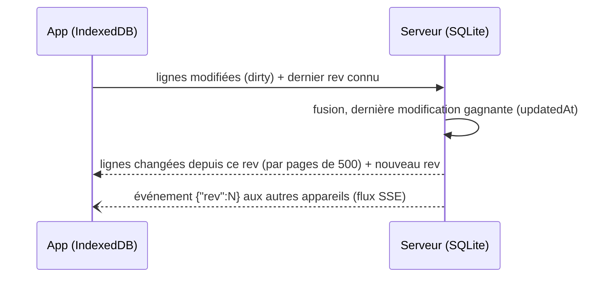

# Architecture

Athlos est un monorepo npm en trois paquets TypeScript :

| Paquet | Contenu |
| --- | --- |
| `shared/` | Vocabulaire commun : sports, types d'exercice, muscles, schémas zod de l'API et de la synchro. |
| `server/` | API Fastify, base SQLite (better-sqlite3 + Drizzle), médias (sharp, ffmpeg), Web Push. |
| `client/` | PWA React + Vite, base locale IndexedDB (Dexie), service worker Workbox. |

En production, une seule image Docker sert l'API et l'application compilée.

## Hors-ligne d'abord

L'application ne lit et n'écrit **que** dans sa base locale IndexedDB. Rien n'attend le réseau : créer une
séance, la faire, consulter l'historique fonctionne pareil avec ou sans connexion.

- Le service worker met en cache l'application (précache Workbox) et les médias des exercices utilisés
  dans tes séances. Toute la bibliothèque d'images peut être téléchargée depuis les Réglages.
- Le stockage est demandé comme persistant (`navigator.storage.persist()`), pour éviter qu'iOS ne l'efface.
- La séance en cours est un état local à l'appareil. Les minuteurs sont des horodatages : ils survivent à
  la mise en veille de l'app.

## Synchronisation

Un seul point d'entrée, `POST /api/v1/sync`, qui envoie les modifications locales et reçoit celles des
autres appareils.

- **Révision globale.** Chaque écriture côté serveur reçoit un numéro `rev` croissant. Un appareil demande
  tout ce qui a changé depuis le dernier `rev` qu'il a vu ; la réponse est paginée (`hasMore`,
  `remaining`, pour afficher la progression du premier téléchargement).
- **Conflits.** Par ligne, la modification la plus récente (`updatedAt`) gagne.
- **Suppressions.** Les lignes ne sont jamais effacées mais marquées `deleted` (tombstones), pour que la
  suppression se propage à tous les appareils.
- **Temps réel.** Les apps ouvertes écoutent `GET /api/v1/events` (Server-Sent Events, lu avec `fetch`
  pour pouvoir envoyer le jeton) et se synchronisent dès qu'un autre appareil a modifié quelque chose.
- **Modes.** Synchro continue par défaut, ou seulement à la maison (le serveur indique si l'appareil est sur
  le réseau local, d'après `HOME_CIDRS`), ou seulement à la fin de la séance, pour économiser les données
  mobiles.
- **Réseau absent.** Une erreur réseau ou une réponse 502 à 504 du reverse proxy est traitée comme
  « hors ligne » : les modifications restent en attente et repartent au retour du réseau.

### Exercices

La bibliothèque (876 exercices de free-exercise-db, traduits en français) est commune. Quand tu modifies un
exercice de la bibliothèque, ta version est stockée à part (`exercise_overrides`) et fusionnée à la volée :
la bibliothèque peut être mise à jour sans écraser tes changements, et « Rétablir l'original » supprime
simplement ta version. Tes propres exercices ont `source: 'custom'`.

Les traductions (`server/src/import/translations-fr.json`) sont appliquées à chaque démarrage, de façon
idempotente.

## Modèle de données

| Table | Rôle |
| --- | --- |
| `users`, `devices` | Utilisateur et appareils connectés (un jeton longue durée par appareil, révocable). |
| `exercises`, `exercise_overrides` | Bibliothèque, exercices perso, versions perso des exercices de la bibliothèque. |
| `workouts`, `workout_items` | Séances planifiées et leurs exercices (séries prévues, repos, supersets). |
| `sessions`, `set_logs` | Séances réalisées et séries effectuées. |
| `media` | Fichiers envoyés (identifiés par leur empreinte sha256). |
| `user_settings` | Réglages partagés entre appareils (couleurs). |
| `push_subscriptions` | Abonnements aux notifications, par appareil (jamais synchronisés). |
| `programs` | Réservé pour la planification de cycles. |

Choix faits pour pouvoir évoluer sans refonte : un `user_id` sur toutes les tables, un champ `sport` (la
course et le vélo sont prévus), des unités SI partout (grammes, mètres, secondes) et des dates en
millisecondes UTC. Les migrations SQL (`server/drizzle/`) s'appliquent au démarrage.

## Médias

- Les fichiers sont nommés par leur empreinte sha256 : un même fichier n'est stocké qu'une fois, et les URL
  `GET /media/<sha256>.webp|mp4` sont mises en cache définitivement.
- Photo → WebP 480 px. Vidéo ou GIF animé → MP4 H.264 480p, 15 s maximum, sans son, plus une image
  d'aperçu (ffmpeg).
- Chaque jour, les fichiers qu'aucun exercice n'utilise sont supprimés, après 7 jours de grâce.

## Authentification

Un seul utilisateur, protégé par un mot de passe dont seule l'empreinte scrypt est stockée
(`APP_PASSWORD_HASH`). Chaque connexion crée un appareil avec son propre jeton, envoyé en
`Authorization: Bearer`. Un appareil peut être déconnecté depuis les Réglages d'un autre. La connexion est
limitée à 10 essais par minute.

## Notification de fin de repos

iOS ne laisse pas une app web en arrière-plan sonner ou vibrer. C'est donc le serveur qui prévient :

1. L'appareil s'abonne une fois (Web Push, clés VAPID créées par le serveur et gardées en base).
2. À chaque repos, l'app envoie `PUT /push/rest { inMs }` ; un nouveau repos remplace le précédent,
   passer le repos l'annule.
3. À l'échéance, le serveur envoie la notification au service d'Apple ou de Google, qui la remet au
   téléphone, même verrouillé, et à la montre.

Les rappels sont gardés en mémoire : un redémarrage du serveur pendant un repos ne fait perdre que ce
rappel. Le bip local reste la solution hors réseau.

## Valider la série depuis l'Apple Watch

Sans app native, la montre passe par un Raccourci iOS qui appelle le serveur avec sa propre clé (un
appareil révocable comme les autres).

1. Pendant la séance, le téléphone publie les séries à venir (`PUT /live`), avec leur nom et leur repos.
2. Le raccourci appelle `POST /live/actions`. Le serveur répond aussitôt en texte (« ✓ Série 1 · Squat —
   Repos 2:00, puis Série 2 · Squat »), lance la notification de fin de repos et met l'action en file.
3. L'app applique les actions en file dès qu'elle en est prévenue (`{"live":1}` sur le flux SSE) ou
   quand elle revient au premier plan, avec l'heure exacte du toucher et les valeurs prévues pour la série.
